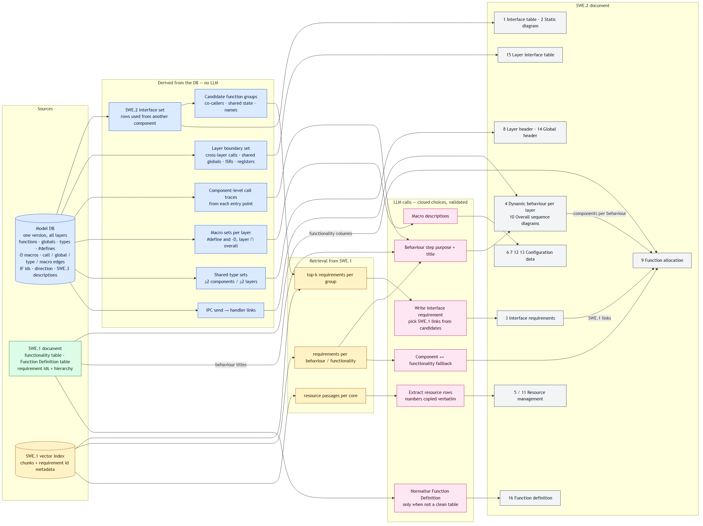
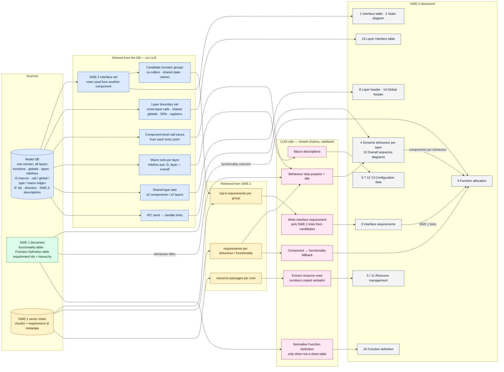

# SWE.2 Software Architecture — generation approach

> How each of the 16 SWE.2 items is produced from three sources: the **model already in the database**
> (what SWE.3 and SWE.4 are built from), the **SWE.1 document read directly**, and the **SWE.1 vector
> index**. Where the LLM is used, and which methods still have to be settled by experiment.
> Shared method: [DOC_GENERATION_PLAYBOOK](../planning/DOC_GENERATION_PLAYBOOK.md). SWE.3 rules this
> reuses: [SWE3_WIKI](../spec/SWE3_WIKI.md). Status: **proposal, 2026-11-04 — nothing built; decisions
> D1–D6 confirmed the same day.**

## Contents

- [The answer in one table](#the-answer-in-one-table)
- [Architecture](#architecture)
- [Sources and what each one can give](#sources-and-what-each-one-can-give)
- [Cross-cutting rules](#cross-cutting-rules)
- [The items, one by one](#the-items-one-by-one) — component (1–3), layer (4–9, 15), overall (10–14, 16)
- [Experiments to run](#experiments-to-run)
- [Decisions](#decisions)
- [Build order](#build-order)

## The answer in one table

**DB** = derived from the stored model · **SWE.1 doc** = read straight from the SWE.1 document (its
tables) · **Vector** = retrieved from the SWE.1 vector index · **LLM** = an LLM call writes or chooses
something · **Exp** = the method needs an experiment before it is fixed.

| # | Item | Scope | DB | SWE.1 doc | Vector | LLM | Exp |
|---|---|---|:-:|:-:|:-:|:-:|:-:|
| 1 | Interface table | component | ● | | | | |
| 2 | Static diagram for interfaces | component | ● | | | | |
| 3 | Requirements for interfaces | component | ● | | ● | ● writes, links | E1, E2 |
| 4 | Dynamic behaviour | layer | ● | | ● | ● step purpose, title | E3, E4 |
| 5 | Resource management | layer | ○ | | ● | ● extracts | E5 |
| 6 | Static configuration data | layer | ● | | ○ | ● description | E6 |
| 7 | Dynamic configuration | layer | ● | | ○ | ● description | E6 |
| 8 | Layer header | layer | ● | | | ○ reuse | |
| 9 | Function allocation | layer | ● | ● columns | ● | ● classifies | E7 |
| 10 | Dynamic behaviour — overall | overall | ● | ● titles | ● | ● | **E8** |
| 11 | Overall resource management | overall | | | ● | ● extracts | E5 |
| 12 | Static configuration — overall | overall | ● | | ○ | ○ reuse | |
| 13 | Dynamic configuration — overall | overall | ● | | ○ | ○ reuse | |
| 14 | Global header | overall | ● | | | ○ reuse | |
| 15 | Layer interface table | layer | ● | | | ○ hardware rows | E9 |
| 16 | Function definition | overall | | ● | | ○ only to normalise | |

● main source · ○ minor or fallback. "Reuse" = text the SWE.3 run already wrote (descriptions), no new call.

**Fully deterministic, buildable now:** 1, 2, 8, 12–14 (plus 6–7 apart from the description). **Need the
LLM and retrieval:** 3, 4, 9, 10. **Mostly SWE.1:** 5, 11, 16. **The hard one:** 10 — linking a call that
leaves one core over IPC to the code that handles it on the next core (E8).

## Architecture

**Colours:** blue = derived from the model DB · green = read directly from the SWE.1 document ·
amber = retrieved from the SWE.1 vector index · pink = an LLM call · grey = a section of the output.
The PNG is rendered from the Mermaid source below (`mmdc`); change the source, then re-render.

It is a SWE.2 **view pass**: new Phase-3 views registered in `engine/views/registry.py` and a SWE.2
exporter in Phase 4 — no new phase ([engine-dev skill](../../.claude/skills/engine-dev/SKILL.md)). It
reads the model a normal run already stored; it does not re-parse. Branch `swe2-gen-rebase`
(2026-09-23) has a ported start — `engine/sad_views/` (layer static diagram, component design
diagram) and `engine/architecture_docx_exporter.py` — to build on.

## Sources and what each one can give

| Source | Gives | Limits |
|---|---|---|
| **Model DB** (`entity_versions`, `content_blobs`, `model_edges`, `model_components`, data dictionary) | every function, global, type and `#define` with its layer, component and unit; `call`, `global_access` (read/write), `type_use`, `macro_use` edges; SWE.3 interface ids, direction and LLM descriptions; `#define` values (parser `_scan_defines`) | sees a cross-layer call **only if both layers are in one version**; does not see IPC as a call; no linker / memory figures |
| **SWE.1 document, read directly** | tables whose structure matters: the functionality table (numbered columns of item 9), Function Definition (item 16), requirement ids and their parent functionality | needs a table reader per document format (DOCX / Polarion export) |
| **SWE.1 vector index** | the requirements most similar to a query, with their ids | chunking loses table structure — so tables are read directly, not retrieved; a chunk must carry its requirement id as metadata, or a link cannot be made |

**Prerequisite:** one version that holds **every layer / core** of the product. A run may span layers
(2026-09-07); items 4, 10, 12–15 depend on it.

## Cross-cutting rules

- **SWE.2 numbers its own interfaces** (D1). An interface row has the id `IF_<LAYER>_<COMPONENT>_<SEQ>`,
  counted per component. It is **not** the SWE.3 id. The two are linked through the entity they share in
  the DB, so nothing is lost for traceability. Input/Output Names in items 3 and 4 are these SWE.2 ids.
  - **Name parts:** SWE.3's shortening rule. Capitals, letters only; the layer part also keeps digits.
  - **`<SEQ>`:** two digits, more once a component passes 99. Functions come first, then globals; each
    set is ordered by unit file name, then line.
- **Ids are stable.** Each id is minted once, stored per project and reused by a later version when its
  key is the same. A new item takes the next free number; nothing is renumbered.

  | Item | Id | Key |
  |---|---|---|
  | 1 | `IF_<LAYER>_<COMPONENT>_<SEQ>` | the function or global (its entity) |
  | 3, 4, 5, 11 | `SAVV8-SwC-<N>` — one number sequence for every SWE.2 requirement (D5) | 3: the sorted ids of its functions · 4: the entry function · 5, 11: the SWE.1 source passage |
  | 15 | `LIF_<LAYER>_<NN>` | the function or global |

  **⚠ Risk with D5:** the client's existing requirements use the same prefix (the sample's
  `SAVV8-SwC-10653`), so a generated number could clash with a real one. Make the first number
  configurable and start it above the client's highest id, or reserve a range with them.
- **SWE.1 links are DB metadata only** (D2). Each requirement's links to SWE.1 are stored with it and
  feed item 9. No document column shows them yet.
- **A wider scope wins** (D3). A macro or type listed overall (items 12, 13, 14) is not listed again per
  layer (items 6, 7, 8).

- **The LLM chooses from a closed set and is checked.** It may write wording, but every id it returns —
  a function id, a SWE.1 requirement id — must be one it was given; every number it returns must appear
  in the passage it was given. A failed check is retried once, then the row is flagged for the reviewer,
  never filled in silently.
- **Cache by fingerprint**, as SWE.3 does (`llm_description_cache`): a requirement whose inputs did not
  change is not asked for again, so an incremental version costs little.
- **Draft, then confirm** — the playbook's rule. Items 3, 4, 9, 10 are drafts a reviewer corrects; the
  review & update mechanism (`engine/review/`) should accept their text as slots later.

## The items, one by one

### Component level

#### 1 Interface table

- **Rows:** a public function or global (SWE.3's rule) **that is used from another component** — a
  caller, reader or writer whose component differs. Used only from units of the same component → no row.
- **Columns:** SWE.3's eight ([N.1.5](../spec/SWE3_WIKI.md#n15--unit-interface-table)) with two changes:
  - **Interface ID** is the SWE.2 id, `IF_<LAYER>_<COMPONENT>_<SEQ>` (D1).
  - **Source/Destination** lists only units of **other** components.

  Direction follows SWE.3's rule, which is D4's meaning: In = a value is set, Out = a value is read.
- **How:** a filter on `model_edges` (reverse lookup on `dst_key`, caller's component ≠ own). Text is the
  SWE.3 description — no LLM call.
- **Output:** the per-component **SWE.2 interface set**, which 2, 3, 4 and 9 read.

#### 2 Static diagram for interfaces

- One block diagram per component, showing **only which components interact** (D6); no interface names
  or ids appear on it.
  - The component sits in the middle.
  - Components that use its interfaces are on the left, with an arrow into it.
  - Components whose interfaces it uses are on the right, with an arrow out. These are read from
    **their** interface sets, so nothing is computed twice.
- **How:** Graphviz, like the flowcharts. Deterministic, no LLM. One plain arrow per pair of components
  and per direction, however many interfaces connect them.
- Start from `component_design_diagram.py` on `swe2-gen-rebase`.

#### 3 Requirements for interfaces

The one component item that needs the LLM. Four steps:

1. **Group (DB).** Cluster the component's interface functions into candidate functionalities:
   called by the same external function, touching the same globals, sharing a name prefix
   (`MTM_Init*`), similar SWE.3 descriptions. A function may sit in more than one group.
2. **Retrieve (Vector).** For each group, query the index with the component name, the function names
   and their descriptions → the top-k SWE.1 requirements, with ids.
3. **Write (LLM)** — one call per component: the groups, each function's id, direction and description,
   and each group's candidates. It returns per requirement: the text, the function ids it covers (from
   the group, may merge or split groups), and the SWE.1 ids it satisfies (from the candidates only).
4. **Check (code).** Every interface function is covered by at least one requirement — an uncovered one
   gets its own; every id is a known one.

**Requirement ID** = `SAVV8-SwC-<N>` (D5). **Input Name** = covered SWE.2 ids with direction **In**;
**Output Name** = those with **Out**. Globals (`In/Out`) go in both. The SWE.1 links from step 3 are
stored with the requirement in the DB, not printed (D2).

**Experiments:** E1 (how to group), E2 (how to retrieve and link).

### Layer level

#### 4 Dynamic behaviour for each layer

1. **Entry points (DB).** Functions of the layer called from another layer, plus IPC handlers and
   task/ISR entries (E8, E9) — what starts work in the layer.
2. **Trace (DB).** Follow the calls from the entry point, collapsed to **component level**: a step is
   written where a call crosses from one component into another (`Service Handler invokes
   SBM_Initialize defined in Shared Buffer Manager`). Work a component does inside itself becomes one
   line when it is significant (`Shared Buffer Manager initializes buffer information`), taken from its
   functions' descriptions. Calls are kept in source order — this is SWE.3's N.2 trace, one level up.
3. **Prune (DB).** Utility components called from everywhere (logging, assert, memory helpers) are left
   out; depth is capped. Which ones count as utility: by fan-in, then confirmed in config (E3).
4. **Select and name (Vector + LLM).** A layer has more entry points than behaviours worth writing.
   Keep the ones that match a SWE.1 functionality (Initialize, Read, Write, Firmware Update…), retrieved
   by the entry function's description; the LLM writes the title.
5. **Write (LLM).** The step skeleton is fixed by code; the LLM fills only each step's **purpose**
   ("to initialize cold boot data"). SWE.3 already writes these purposes for its call descriptions
   (`CallDescriptionGenerator`) — reuse them where the same call exists.

**Input / Output Name:** the ids of the step functions that are in SWE.2 interface sets, split by
direction. **Experiments:** E3 (which behaviours, what to prune), E4 (call order).

#### 5 Resource management for each layer

- **Retrieve (Vector).** Queries per layer / core: memory regions (ITCM, DTCM, SRAM), utilization
  limits, CPU load, stack, heap.
- **Extract (LLM).** The passages → rows (Requirement, Input Name, Output Name). **Numbers are copied,
  never computed or invented**: the check rejects any number not in the passage. Each row keeps the
  SWE.1 id it came from.
- **DB** gives only the layer's name and its code units for the Input/Output wording.
- **Optional input:** the linker map file per core, which gives the real use (`590.9 KB of 622 KB`)
  to check the limit against. Not in the DB today.

**Experiment:** E5.

#### 6 Static configuration data — per layer

- **Candidates (DB):** the `#define` entries of the layer's sources (value and location stored at
  parse; inactive `#if` branches already dropped). Object-like only.
- **Selection:** not every `#define` is configuration — a code base has thousands. Proposed rule:
  defined in a configuration header (name pattern, set per project) **or** used by two or more
  components (`macro_use`), with a constant value. Settle on real code (E6).
- **Name / Data:** from the DB. **Description:** the comment beside the `#define` when there is one,
  else the LLM from name, value and where it is used; SWE.1 retrieval when the name appears there.
- A macro that is the same in every core is listed only in item 12, not here (D3).

#### 7 Dynamic configuration — per layer

- **Candidates (DB):** the `-D` macros the layer is compiled with — from its core's
  `compile_commands.json` and the layer's macro file (`layers.<L>.macros`), both already read in
  Phase 1. **Check:** whether they are stored per version today; if not, Phase 1 stores them (small).
- Name / Data / Description as item 6. A macro given to every core moves to item 13.

#### 8 Layer header

- Types — struct, class, union, enum, typedef — whose users (`type_use`) are in **two or more
  components of the layer**. Cell content and description: SWE.3's unit header table formatter and its
  stored descriptions ([N.1.4](../spec/SWE3_WIKI.md#n14--unit-header-table)) — no new LLM call.
- A type that is also used in another layer is listed only in item 14, not here (D3).
- **Fix first:** the parser keys type users by type name, not by layer (`engine/parser.py`, the
  `type_users` comment) — two layers with a same-named type merge. Items 8 and 14 need it keyed by layer.

#### 9 Function allocation — per layer

- **Columns (SWE.1 doc):** the numbered functionalities of SWE.1's functionality table, read directly.
- **Rows (DB):** the layer's groups and components.
- **A dot, from evidence**, strongest first:
  1. one of the component's interface requirements (item 3) links to a SWE.1 requirement of that
     functionality;
  2. the component has a step in a dynamic behaviour (4 / 10) mapped to that functionality;
  3. fallback — the LLM, given the component's description and the functionality's retrieved
     requirements, says yes / no.
- Each dot keeps its evidence so a reviewer can see why it is there. **Experiment:** E7.

#### 15 Layer interface table

- **Rows (DB):** what crosses the layer's boundary —
  - functions of the layer called from another layer, and functions of other layers it calls;
  - globals read or written from another layer (shared memory);
  - IPC send points and handlers (E8);
  - hardware: ISRs and register access (E9).
- **Columns:** Interface Name, Information (SWE.3 description; LLM only for hardware rows that have
  none), Direction, Source/Destination (the component on the other side), Interface Type
  (Function / Global Variable), Reference (`LIF_<LAYER>_<NN>`, stable).
- **Direction** (D4): **In** = a value is set, **Out** = a value is read.
  - **Function rows:** SWE.3's direction rule, which already means this. `set` → In; `get`, or a return
    value → Out; otherwise writing a global → In.
  - **Global rows:** decided by how the other layer uses the global. It only writes it → **In**; it only
    reads it → **Out**; it does both → **In/Out**.
  - **Hardware rows:** a register write → In; a register read or an ISR delivering data → Out.

### Overall

#### 10 Dynamic behaviour — overall

- One entry per behaviour (Initialize, Read, …): titles from SWE.1's functionality list.
- **Sequence diagram** (Mermaid, like SWE.3's behaviour diagrams): participants are components, boxed by
  layer. Messages: each component's trigger function, the IPC a layer sends, and the function that
  runs in the next layer when it arrives. Built by joining the per-layer behaviours (item 4) end to end.
- **The join is the crux.** A call into an IPC primitive is not a call to the receiver: there is no
  edge across cores. It needs (E8):
  1. the project's IPC send and receive primitives, named in config;
  2. the message id at each send — a constant argument at the call site, which Phase 1 does not store
     today;
  3. the receiver's dispatch — a `switch` on the message id or a handler table — mapping id → handler.
  Then send(id) → handler(id) is a link like any other. Fallback when the code does not show it: a
  mapping file the client provides, or LLM-suggested pairs a reviewer confirms.

#### 11 Overall resource management

- A table per core of CPU load and memory use. Same method as item 5, at software scope, from SWE.1
  retrieval. Optional: the map files.

#### 12 / 13 Static and dynamic configuration — overall

- The macros that are the same — name **and** value — in every core: the intersection of the per-layer
  sets of items 6 and 7. Descriptions reused from 6 / 7. No new call.

#### 14 Global header

- Types used by components in **two or more layers**. Same machinery as item 8, after the same fix.

#### 16 Function definition

- **SWE.1 doc**, read directly: Function Name, Description, Input and Output, one row per function of
  the product. No retrieval — the table is copied. The LLM is used only if SWE.1 writes it as prose, to
  split it into the three columns, with the text kept word for word.

## Experiments to run

Each needs the real code base and, where it says so, a sample SWE.2 the client has written by hand to
measure against.

| Id | Question | How to test | Pass when |
|---|---|---|---|
| **E1** | How to group interface functions into functionalities (item 3) | Compare on 3–5 components: (a) call-graph signals only, (b) description-embedding clustering, (c) LLM groups from the whole list, (d) **requirement-first** — start from the retrieved SWE.1 requirements and assign functions | grouping agrees with the client sample; every function covered |
| **E2** | How to link to SWE.1 (items 3, 9) | Vary the query (names only / descriptions / both), k, chunk size, a similarity floor, with and without an LLM re-rank | link precision and recall against hand-made links on 50 functions |
| **E3** | Which entry points are behaviours, what to prune (item 4) | Run the trace on one layer; fan-in threshold for utility components; depth cap | the client's FTL Initialize example is reproduced, nothing essential missing, no noise |
| **E4** | Call order inside a trace (item 4) | Check whether `model_edges` keeps call-site order; otherwise take it from the CFG the flowchart engine builds | steps read in source order |
| **E5** | Can retrieval find resource data, and extract it safely (5, 11) | 20 queries over SWE.1; number-check on the output | every limit in SWE.1 found; no number the source lacks |
| **E6** | Which `#define`s are configuration (6, 7) | Try the rule on one layer; count candidates; client marks a sample | the list is short enough to review and matches the sample |
| **E7** | Function allocation evidence (9) | Build the matrix from rules 1–2 only, then add the LLM fallback | dots agree with the client's matrix; the LLM adds more than it gets wrong |
| **E8** | IPC links across cores (10, 15) | Find the IPC primitives in the code base; prototype message-id capture at call sites and dispatch reading on one pair of cores | ≥ 90 % of sends link to a handler on the sample pair |
| **E9** | Hardware interfaces (15) | Find ISRs (vector table, attributes, names), register access (`volatile` casts of constant addresses, register macros) | the client confirms the list for one layer |

E8 is the riskiest: start it first, in parallel with building the deterministic items.

## Decisions

Confirmed 2026-11-04.

| Id | Question | Decision |
|---|---|---|
| D1 | Interface ids in SWE.2 | SWE.2's own ids, `IF_<LAYER>_<COMPONENT>_<SEQ>`. SWE.3's ids are not used |
| D2 | Where the links from item 3 to SWE.1 go | DB metadata only, for now. Not printed |
| D3 | A macro or type that fits both scopes | listed overall only; overall wins |
| D4 | Direction | In = a value is set, Out = a value is read |
| D5 | Requirement id format | `SAVV8-SwC-<N>` — see the clash risk under [ids](#cross-cutting-rules) |
| D6 | What the static diagram (item 2) shows | component interactions only, no interface names or ids |
| D7 | Open: the first number for `SAVV8-SwC-` | above the client's highest existing id, or a range they reserve |

## Build order

1. **Deterministic items, no LLM:** 1, 2, 8, 14, 12–13, 6–7 without descriptions, 15 without IPC and
   hardware rows — and the per-layer type fix. Proves the view pass and the exporter.
2. **SWE.1 ingest:** the table reader (functionality table, Function Definition) → item 16, the
   columns of item 9; confirm the vector index carries requirement ids.
3. **E8 and E9 spikes**, in parallel with 1–2.
4. **LLM items:** 3 (after E1, E2), 4 (after E3, E4), 5 / 11 (after E5), descriptions for 6 / 7.
5. **Roll-ups:** 9, then 10 once E8 holds.
